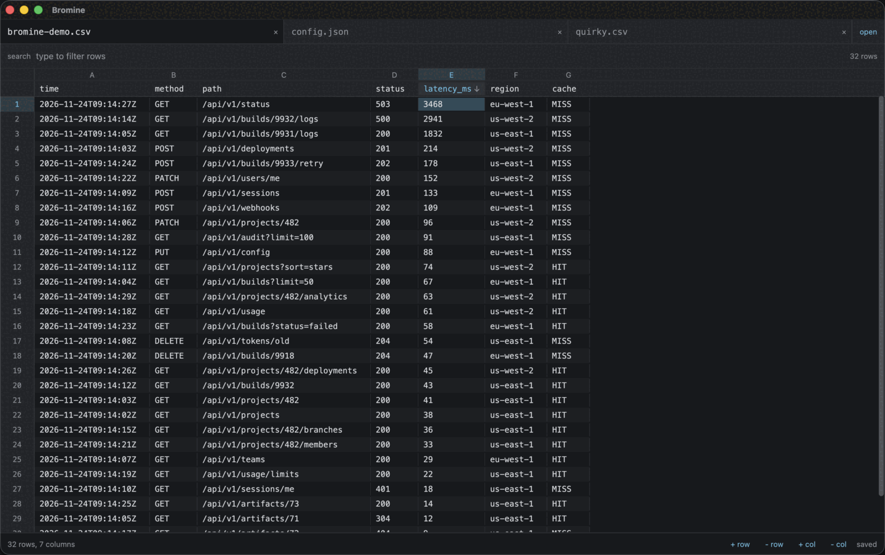
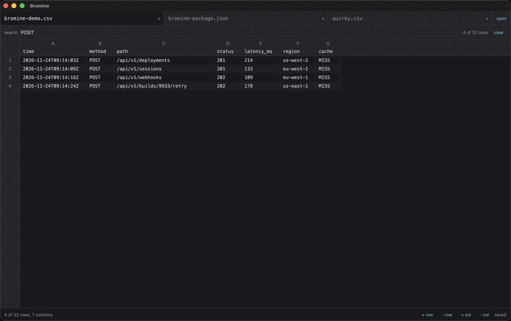
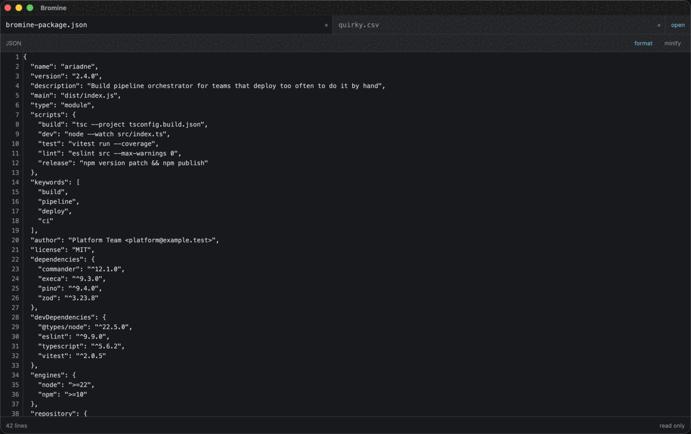

<p align="center">
  
</p>

<h1 align="center">Bromine</h1>

<p align="center">
  <strong>The data viewer for files you keep opening in a terminal.</strong><br>
  CSV, TSV, and JSON in a fast, native macOS window.
</p>

<p align="center">
  <a href="https://github.com/Jbcampbe/bromine/releases/latest">
    
  </a>
</p>

<p align="center">
  
  
  
</p>

---

Every developer has a folder of files that are *almost* data: a CSV export from
a dashboard, a JSON response saved to disk, a TSV someone pasted into Slack.
Bromine is the window for those files.

It opens a file, draws only the rows you can see, and tells you the truth about
what is there instead of quietly normalizing it. No import step, no database, no
upload, no telemetry.



<p align="center"><em>A 32-row request log sorted by <code>latency_ms</code>. The marked cell, its row number, and its column letter all agree on where the mark is.</em></p>

## What you get

- **One window for the awkward formats.** Comma- and tab-delimited text, quoted
  commas and embedded newlines, ragged rows, JSON with keys in the order they
  were written. Markdown is next.
- **Speed that holds up on big files.** Rows and JSON lines are virtualized. A
  200,000-row CSV is parsed once and only the visible rows are ever laid out.
- **The spreadsheet conventions you already know.** Row numbers down the left
  edge, column letters `A` to `Z` to `AA` along the top, and a header that sorts.
- **Enough editing to fix the file you opened.** Add or remove rows and columns,
  then write it back with `Cmd+S`. No save-as-you-type.
- **Bad news, stated plainly.** Repaired rows, lossily decoded bytes, and
  read-only files show up in the status strip instead of disappearing.

## Sort, filter, mark, copy



Click a column header to sort it. Numeric columns sort as numbers, so `9` comes
before `10`, and clicking the same header again reverses the order. Type into the
search bar to filter as you type; each tab keeps its own sort and query.

A mark is exactly one thing: a cell, a row, or a column. Click a cell, a row
number, or a column letter, or move the mark with the arrow keys. The mark gets a
wash, and the row number and column letter beside it light up, so a mark inside a
wide row still says where it started.

`Cmd+C` copies the mark in the shape a spreadsheet or text editor expects:

| Mark | Copied as |
| :--- | :--- |
| Cell | Its value |
| Row | One row of tab-separated values |
| Column | One value per line |

Scroll in one axis at a time: a trackpad gesture keeps the direction it started
in, so a diagonal swipe does not drag the grid diagonally. Thin scrollbars along
the right and bottom edges show where in the file you are.

## JSON, line by line



Bromine shows JSON as a numbered line view, not a tree. The line a parser
complained about stays easy to reach, and the whole file stays visible.

- **Format or minify.** Indented is for reading; one line is for confirming the
  shape of a record. The active mode is accented.
- **The order of keys is the file's order.** Formatting changes whitespace and
  nothing else.
- **A giant document is never flattened.** Past 400 KB minified, the view stays
  formatted and says why, because shaping millions of characters onto one line
  would freeze the window.
- **Parse errors name the place.** A malformed file reports
  `path:line:column: message`.
- **Read only, and it says so** in the status strip.

## Tabs, edits, and saves

Keep several files open at once as tabs. `Cmd+O` opens files from a native panel,
`Cmd+W` closes the visible one, and reopening a path you already have focuses its
tab instead of making a duplicate. Every tab keeps its own scroll, sort, and
search.

Rows and columns can be added and removed from the status strip. A new row lands
below the marked row, or at the end of the file when nothing is marked; a new
column lands to the right of the marked column. Edit first, then save: the strip
says "unsaved changes" until `Cmd+S` has written the file.

Closing a dirty tab, or quitting the app, asks twice. One keystroke must not be
able to throw work away.

## Honest about the file

The status strip is the app's conscience. It reports the row and column counts,
whether the file has unsaved changes, and anything the parser had to do to make
the file displayable.

- Ragged rows are padded, unnamed columns are named, and the strip says how many.
- A file that is not valid UTF-8 is decoded lossily and marked read-only, because
  writing it back would replace bytes Bromine could not read.
- Repairs made at load do not block a save: what gets written is the rectangle
  you are looking at.
- There is no undo yet. The app is blunt about unsaved work rather than pretending
  a structural edit is free.

## Install

Download the dmg for your Mac from the
[latest release](https://github.com/Jbcampbe/bromine/releases/latest), drag
**Bromine** onto the **Applications** shortcut, and launch it. No Rust toolchain
is needed.

- **Apple Silicon** (M1 and later): `Bromine-<version>-aarch64.dmg`
- **Intel**: `Bromine-<version>-x86_64.dmg`

Requires macOS 11 or newer.

These builds are **ad-hoc signed, not notarized**: there is no paid Apple
Developer ID behind them, so macOS quarantine refuses the first launch. Either
right-click the app and choose **Open** once, or clear the flag:

```bash
xattr -dr com.apple.quarantine /Applications/Bromine.app
```

`SHA256SUMS.txt` on the release verifies a download:

```bash
shasum -a 256 -c SHA256SUMS.txt
```

## Under the hood

Bromine is Rust 2024 on [GPUI](https://gpui.rs), the UI framework behind Zed. It
is a native window with native text shaping and a native menu bar, not a web view
in a trench coat.

| Layer | Responsibility |
| :--- | :--- |
| `crates/bromine-core` | CSV/TSV and JSON parsing, the table model, sorting, searching, and write-back. **No GPUI dependency.** |
| `crates/bromine-ui` | The GPUI views: tab strip, CSV grid, JSON line view, status strip, and theme tokens. |
| `crates/bromine` | The binary: arguments, menu bar, file loading, and window setup. |

That crate boundary is a hard rule, not an aspiration. Every behaviour worth
trusting lives in core, where tests run headlessly. The full suite is **123
tests**: 56 core, 10 fixture contracts, 51 views, and 6 CLI. The view tests drive
real GPUI frames: they type into the window, click headers and status buttons,
dispatch wheel events, send `Cmd+C`, `Cmd+S`, and `Cmd+W` through the real keymap,
and assert on laid-out bounds.

GPUI is pinned to exactly `0.2.2` and is not upgraded as a side effect. The
workspace enables its `runtime_shaders` feature so the app builds with Xcode
Command Line Tools alone; Metal shaders compile on first launch instead of at
build time.

Some measured numbers from a dev build:

| Fixture | Work | Time |
| :--- | :--- | ---: |
| 200,000-row CSV | Parse, then measure every column width | 231 ms + 22 ms |
| 26 MB JSON, 200,000 records | Read, parse, format to 40 MB, split into 2.4 M lines, scan | ~1.2 s |

After that, only what is on screen is drawn.

## Status

Bromine is early, deliberately small, and open source. CSV/TSV and JSON are wired
end to end. What is not there yet:

- Typing into a cell, with a caret, selection, and undo
- A Markdown view
- Editing JSON, or collapsing it into a tree
- Dragging column edges, draggable scrollbars, and reordering tabs
- Searching inside a JSON document

## Development

### Requirements

- macOS 11 or newer. GPUI is cross-platform, but this app has only been built
  and run on macOS.
- Rust 1.90 or newer.
- Xcode Command Line Tools. Full Xcode is not required; see the `runtime_shaders`
  note above.

### Run it

```bash
cargo run -p bromine -- fixtures/people.csv fixtures/quirky.csv   # two tabs
cargo run -p bromine                                              # empty window
```

The first build takes several minutes (measured: about 6 minutes and 3 GB of
artifacts) because the GPUI dependency tree is compiled optimized. Later builds
of our own code take seconds. `cargo check` gives fast type feedback without
paying that cost.

### Test and lint

```bash
cargo fmt --all
cargo clippy --workspace --all-targets -- -D warnings
cargo test --workspace
```

A passing suite does not show that a window renders. For any UI change, launch
the app on a fixture and look at it:

```bash
cargo run -p bromine -- fixtures/people.csv
```

Large fixtures for grid and JSON work come from
`./scripts/make-large-fixture.sh 200000`, which writes `large.csv` and
`large.json` under `fixtures/generated/` (not committed).

### Where things live

| Path | What lives there |
| :--- | :--- |
| `crates/bromine-core` | Format engines. Parsing, the table model, sort, search, write-back. No UI. |
| `crates/bromine-ui` | GPUI views. The CSV grid, the JSON view, the workspace, and the theme tokens. |
| `crates/bromine` | The binary: arguments, menu bar, window. |
| `assets/` | `icon.svg` (the icon source) and the committed `AppIcon.icns`. |
| `packaging/` | The `Info.plist` template the bundle script stamps. |
| `.github/workflows/` | The tag-driven release workflow. |
| `fixtures/` | Sample data shared by tests, development, and QA runs. |
| `scripts/` | Developer helpers: large fixtures, icon rendering, and the macOS bundler. |
| `docs/screenshots/` | The images in this README. |

`AGENTS.md` documents the hard rules and the GPUI 0.2.2 API notes that cost a
compile cycle to learn. `DESIGN.md` records the visual brief.

### Build a bundle

```bash
cargo build --release --target aarch64-apple-darwin -p bromine
./scripts/bundle-macos.sh aarch64-apple-darwin 0.1.0 aarch64
```

That writes `dist/Bromine.app` and `dist/Bromine-0.1.0-aarch64.dmg`. Set
`SIGN_IDENTITY` to a Developer ID identity to sign with it instead of ad-hoc.
The icon is regenerated from `assets/icon.svg` with `./scripts/make-icon.sh`
(needs `rsvg-convert`).

### Releases

A tag that starts with `v` builds both architectures on GitHub's macOS runners,
runs the workspace tests on each, and publishes one GitHub Release with both
dmgs and a single `SHA256SUMS.txt`:

```bash
git tag v0.1.0
git push origin v0.1.0
```

The workflow lives in `.github/workflows/release.yml`. Releases need no secrets;
the default build is ad-hoc signed. Setting `MACOS_CERT_P12`,
`MACOS_CERT_PASSWORD`, `APPLE_ID`, `APPLE_TEAM_ID`, and `APPLE_APP_PASSWORD`
switches it to a Developer ID signature and notarizes the dmgs.

## License

[MIT](LICENSE) © 2026 Josiah Campbell
